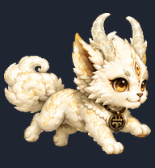

# desk-pet

Codex 自定义桌宠仓库。目前收录的是新版 **白泽阿衡**：一只雪白、蓬松、带月白玉角和琥珀金眼的幼年白泽。




## 白泽阿衡

- 宠物 ID：`baize-aheng`
- 图集规格：Codex v2，`1536×2288`，`8×11`，RGBA WebP
- 脸颊和胸口有柔软的绒毛层次，淡金纹带一点珍珠釉面光泽。
- 悬停时先保持待机坐姿，短暂停住后轻动耳尖。悬停首帧和回到待机的姿势逐像素一致。
- 左右侧跑保持接近正面的体量，收腿时祥云尾尖稍晚回摆，尾巴与身体之间保留留白。
- 趴卧从低头、伏下到抬眼坐回；16 个转头方向重新接顺了正上方和正下方的过渡。

[查看完整动作图集](docs/images/baize-aheng-contact-sheet.png) · [查看快速切换模拟](docs/images/baize-aheng-hover-edge-compare.gif) · [查看验证摘要](qa/validation.json)

## 安装

在仓库根目录执行：

```bash
mkdir -p "${CODEX_HOME:-$HOME/.codex}/pets/baize-aheng"
cp pets/baize-aheng/pet.json "${CODEX_HOME:-$HOME/.codex}/pets/baize-aheng/pet.json"
cp pets/baize-aheng/spritesheet.webp "${CODEX_HOME:-$HOME/.codex}/pets/baize-aheng/spritesheet.webp"
```

随后在 Codex 的“设置 → 宠物”页面点击刷新，选择“白泽阿衡”。如果是更新原有的白泽，先切换成另一只宠物，再切回白泽，重新加载图集。

## 仓库口径

本仓库只保留当前最新版和必要的预览、验证摘要。旧版备份、生成缓存、临时图集及本机绝对路径均不纳入版本控制。
